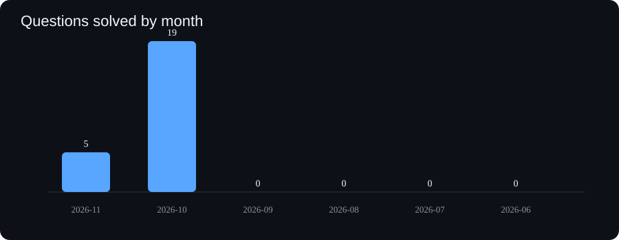
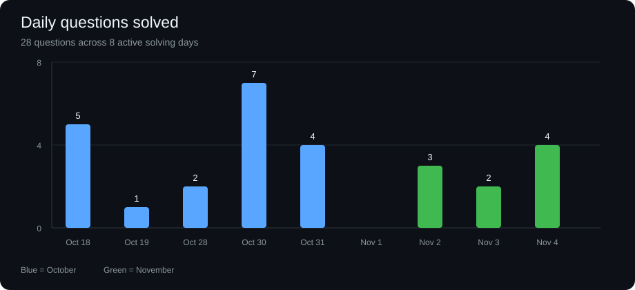
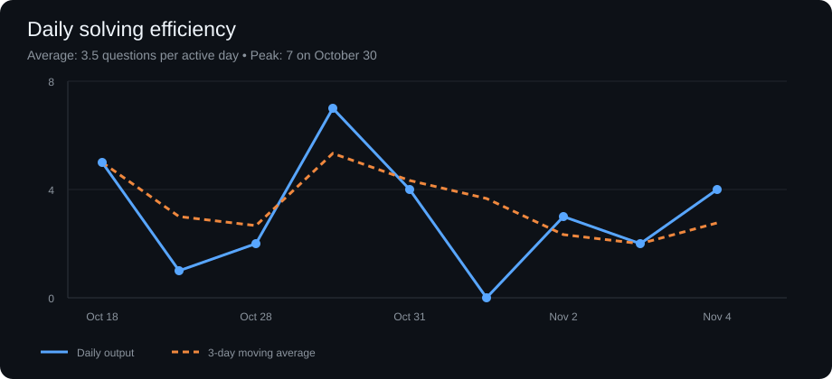
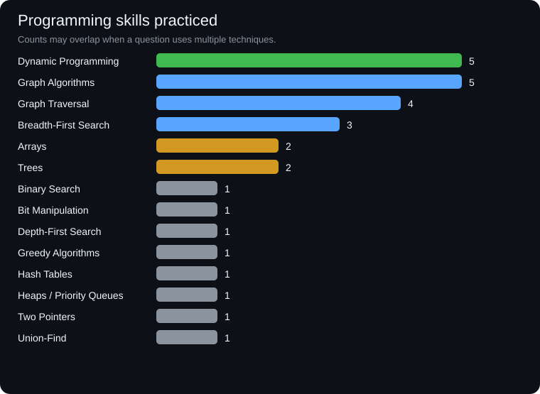

# Competitive Programming Progress

> A visual, Git-backed dashboard of my data structures, algorithms, and problem-solving practice.

## Progress at a glance

| Metric | Result |
| --- | ---: |
| **Total questions solved** | **36** |
| **Solved today (2026-11-07)** | **5** |
| **Solved this month (November 2026)** | **19** |
| **Solved before this month** | **17** |
| **Active solving days** | **9** |
| **Average per active day** | **4.0** |
| **Platforms** | **2** |
| **Programming languages** | **1** |

## Day-to-day progress

## Daily efficiency

Efficiency is measured as questions solved per active solving day. The chart compares daily output with a 3-day moving average.

## Programming skills demonstrated

The skills below are inferred from solution folders and problem names. Counts can overlap because one question may demonstrate multiple techniques.

| Skill | Questions |
| --- | ---: |
| Dynamic Programming | 5 |
| Graph Algorithms | 10 |
| Breadth-First Search | 5 |
| Graph Traversal | 7 |
| Arrays | 2 |
| Trees | 2 |
| Binary Search | 2 |
| Bit Manipulation | 1 |
| Depth-First Search | 2 |
| Greedy Algorithms | 1 |
| Hash Tables | 2 |
| Heaps / Priority Queues | 1 |
| Two Pointers | 1 |
| Union-Find | 1 |

## Platform and language breakdown

| Platform | Solved |
| --- | ---: |
| LeetCode | 21 |
| GeeksforGeeks | 15 |
| **Total** | **36** |

| Language | Solved |
| --- | ---: |
| Python | 36 |

## Difficulty breakdown

| Platform | Basic / Easy | Medium | Hard |
| --- | ---: | ---: | ---: |
| GeeksforGeeks | 7 | 7 | 1 |
| LeetCode | — | — | — |

## Activity summary

- **Today:** 5 questions solved.
- **This month:** 19 questions solved in November.
- **Before this month:** 17 questions solved in October.
- **Most productive day:** 2026-10-30 with 9 questions.
- **Average efficiency:** 4.0 questions per active solving day.
- **Current streak:** 1 calendar day with solutions added (November 7).

## Latest solved questions

| Question | Platform | Skill / category | Solved on |
| --- | --- | --- | --- |
| `Shortest Path in Unweighted Graph` | GeeksforGeeks | Graph Algorithms / BFS | 2026-11-07 |
| `Shortest Path in Directed Acyclic Graph` | GeeksforGeeks | Graph Algorithms / DFS | 2026-11-07 |
| `Minimum Days` | GeeksforGeeks | Arrays / Greedy | 2026-11-07 |
| `Generate Usernames` | GeeksforGeeks | Hash Tables | 2026-11-07 |
| `2747-Count-Zero-Request-Servers` | LeetCode | Sliding Window | 2026-11-07 |
| `1385-Find-the-Distance-Value-Between-Two-Arrays` | LeetCode | Binary Search | 2026-11-05 |
| `210-Course-Schedule-II` | LeetCode | Graph Algorithms / BFS | 2026-11-04 |
| `207-Course-Schedule` | LeetCode | Graph Algorithms / BFS | 2026-11-04 |
| `462-Minimum-Moves-to-Equal-Array-Elements-II` | LeetCode | Arrays / Sorting | 2026-11-04 |
| `Directed Graph Cycle` | GeeksforGeeks | Graph Algorithms / DFS | 2026-11-04 |
| `3505-Minimum-Operations-to-Make-Elements-Within-K-Subarrays-Equal` | LeetCode | Dynamic Programming | 2026-11-04 |
| `XOR of All Subarray XORs` | GeeksforGeeks | Bit Manipulation | 2026-11-04 |
| `3736-Minimum-Moves-to-Equal-Array-Elements-III` | LeetCode | Arrays | 2026-11-03 |
| `Topological Sort` | GeeksforGeeks | Graph Algorithms | 2026-11-03 |
| `130-Surrounded-Regions` | LeetCode | Union-Find | 2026-11-02 |
| `542-01-Matrix` | LeetCode | Dynamic Programming / BFS | 2026-11-02 |
| `453-Minimum-Moves-to-Equal-Array-Elements` | LeetCode | Arrays | 2026-11-02 |

## Repository layout

- [`leetcode/`](./leetcode) — LeetCode solutions organized by algorithm/topic.
- [`geeksforgeeks/`](./geeksforgeeks) — GeeksforGeeks solutions organized by difficulty.
- [`assets/`](./assets) — SVG charts embedded in this dashboard.

Stats are based on tracked solution files and their first-added Git commit. Last updated: 2026-11-07.

---

<!-- cf-sync -->
# Competitive Programming Solutions

Synced automatically by SolveBase.

**Total solved: 52**

## Codeforces

Solutions by [sd449420](https://codeforces.com/profile/sd449420), organized by difficulty rating.

**Solved: 0**

| Difficulty | Solved |
| --- | --- |
| — | 0 |

## LeetCode

Solutions organized by primary topic folder.

**Solved: 31**

| Topic | Solved |
| --- | --- |
| [1-two-sum](./leetcode/1-two-sum) | 1 |
| [array](./leetcode/array) | 4 |
| [backtracking](./leetcode/backtracking) | 1 |
| [binary-search](./leetcode/binary-search) | 2 |
| [bit-manipulation](./leetcode/bit-manipulation) | 1 |
| [breadth-first-search](./leetcode/breadth-first-search) | 2 |
| [dynamic-programming](./leetcode/dynamic-programming) | 7 |
| [graph](./leetcode/graph) | 3 |
| [hash-table](./leetcode/hash-table) | 1 |
| [heap-priority-queue](./leetcode/heap-priority-queue) | 1 |
| [sliding-window](./leetcode/sliding-window) | 2 |
| [tree](./leetcode/tree) | 2 |
| [two-pointers](./leetcode/two-pointers) | 2 |
| [union-find](./leetcode/union-find) | 2 |

## CSES

Solutions from the CSES Problem Set, organized by section.

**Solved: 0**

| Section | Solved |
| --- | --- |
| — | 0 |

## CodeChef

Solutions organized by difficulty rating.

**Solved: 0**

| Difficulty | Solved |
| --- | --- |
| — | 0 |

## GeeksforGeeks

Solutions organized by difficulty level.

**Solved: 21**

| Difficulty | Solved |
| --- | --- |
| [Basic](./geeksforgeeks/Basic) | 2 |
| [Easy](./geeksforgeeks/Easy) | 7 |
| [Medium](./geeksforgeeks/Medium) | 11 |
| [Hard](./geeksforgeeks/Hard) | 1 |

_Last updated: 2026-11-11_
<!-- /cf-sync -->
